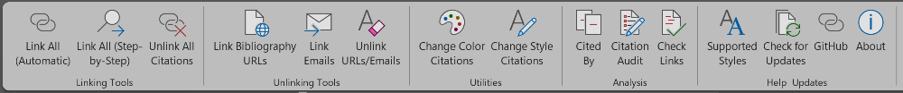
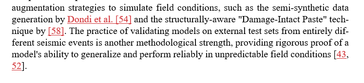
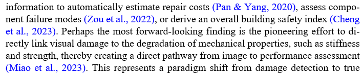
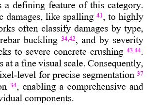
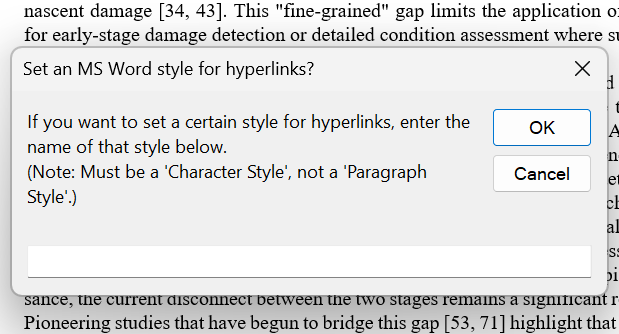
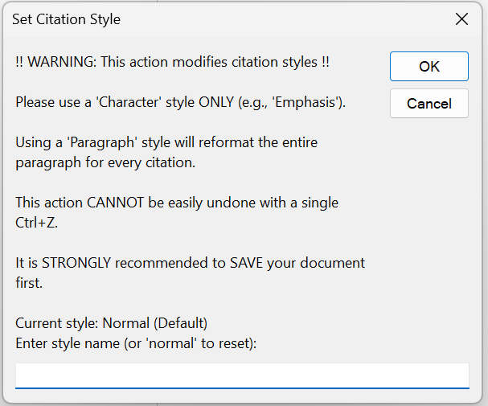
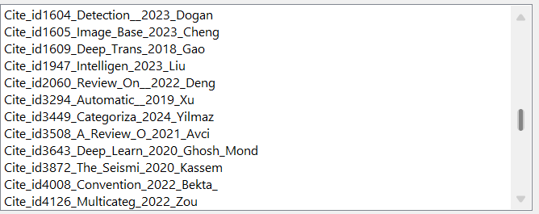

# ZoteroCiteLinker

**Turn every in-text Zotero citation into a clickable link to its bibliography entry.**

ZoteroCiteLinker is a Word add-in that reads the Zotero citation fields already in your document — `[1]`, `(Author, 2020)`, `(Author, 2020, p. 14)` — and links each one to the matching entry in your Zotero bibliography. One click, and every citation becomes a jump target: forward to the reference, back to the sentence that used it.

It also tells you what your citations look like: which references are never cited, how many times each one is used, on which pages, and whether any link has gone stale.

**[⬇️ Download ZoteroCiteLinker.dotm](https://github.com/sBaydin/ZoteroCiteLinker/releases/latest/download/ZoteroCiteLinker.dotm)** · [All releases](https://github.com/sBaydin/ZoteroCiteLinker/releases) · [What's new in 2.6.0](https://github.com/sBaydin/ZoteroCiteLinker/releases/tag/v2.6.0)

## ✨ What it does

* **One-click linking** — every citation in the document, linked in a single pass.
* **Links that stay alive** — the document remembers its own link state, so a rebuilt bibliography gets a one-click repair instead of a manual relink.
* **Cited By** — put the cursor on a reference and see every citation that points back to it, with page numbers.
* **Citation Audit** — an interactive HTML report: uncited sources, citation counts, pages, broken links.
* **Link Check** — a plain answer to "are my links still working?", with the broken ones listed.
* **URL and e-mail activation** — for the bibliography, or for the whole document.
* **Formatting** — colour the citations, or apply your own Word character style.
* **21 citation styles**, numeric and author–year, all bundled.
* **One file, two platforms** — the same `.dotm` runs on Word for Windows and Word for macOS.

## 🚀 Install

The add-in is a single `.dotm` file placed in Word's trusted STARTUP folder. Word then loads the **Zotero Linker** tab on every start.

Requirements: Word 2010 or newer on Windows, Word 2016 or newer on macOS, and Zotero 6 or 7 with its Word plugin installed.

### Windows

1. **[Download `ZoteroCiteLinker.dotm`](https://github.com/sBaydin/ZoteroCiteLinker/releases/latest/download/ZoteroCiteLinker.dotm)** (right-click → *Save As…* if your browser opens it instead).
2. In Word: **File → Options → Trust Center → Trust Center Settings… → Trusted Locations**. Find the entry described as **User STARTUP** and copy its path — usually
   `C:\Users\<YourUserName>\AppData\Roaming\Microsoft\Word\STARTUP`.
3. Paste that path into File Explorer's address bar and copy the `.dotm` into the folder.
4. Restart Word. If a yellow **SECURITY WARNING** bar appears, click **Enable Content**. The **Zotero Linker** tab is now on the ribbon.

### macOS

1. Download the same file.
2. In Finder press `Shift + Command + G` and open
   `~/Library/Group Containers/UBF8T346G9.Office/User Content/Startup/Word`.
3. Move `ZoteroCiteLinker.dotm` into that folder.
4. Restart Word and click **Enable Macros**. The **Zotero Linker** tab appears.

The shipped `.dotm` is the same on both platforms: Word for macOS has no `Scripting.Dictionary`, `VBScript.RegExp` or `MSXML2`, so the add-in carries a Mac-specific code path internally.

Building from source

The `src/` folder is only needed to inspect or rebuild the add-in. Open the base template in Word, press `Option + F11` (macOS) or `Alt + F11` (Windows), then use **File → Import File…** to import:

* `src/ZoteroCiteLinker.bas` — the add-in itself,
* `src/ZCLAppEvents.cls` — the document events used by the self-healing check,
* `src/CustomDictionary.cls` — the macOS dictionary replacement.

Then **Debug → Compile VBAProject** and save as a macro-enabled template. The ribbon lives in `src/customUI14.xml`.

## ⚠️ Before you start

**Back up your document.** These are macros that rewrite links and formatting; a backup copy is the difference between a five-second undo and a lost afternoon. Unlinking and relinking is safe by design, but a backup costs nothing.

## 📖 The ribbon, button by button

Descriptions follow the left-to-right order of the tabs: **Linking Tools**, **Unlinking Tools**, **Utilities**, **Analysis**, **Help & Updates**.

### Linking Tools

* **Link All (Automatic)** — removes the previous links and relinks every Zotero citation in the document, reporting how many were created. The status bar shows the progress (`citation 12 of 180`); press **Esc** to stop early, and the links made so far are kept. Zotero must be running.
* **Link All (Step-by-Step)** — the same pass, one citation group at a time, asking Yes / No / Cancel for each. Useful when a document has citations the automatic pass should skip. Zotero must be running.
* **Unlink All Citations** — removes only the links this add-in created and resets their colour. Web links, e-mails and your table of contents are left alone.

After a successful pass the document stores a small fingerprint of its own link state. That is what makes the links self-healing: the next time the document is opened, a fingerprint mismatch is repaired with a single question instead of a silent failure, and a document that was never linked is skipped without any scan. Repairing never needs Zotero to be running, because the citation data lives inside the citation fields.

### Unlinking Tools

* **Link Bibliography URLs** — finds plain-text URLs inside the bibliography and makes them clickable.
* **Link Emails** — finds e-mail addresses anywhere in the document and turns them into `mailto:` links.
* **Unlink URLs/Emails** — removes every `http://` and `mailto:` link in the document, leaving citation links untouched.

### Utilities

* **Change Color Citations** — pick a colour (Blue, Red, Auto/Black, …) and apply it to every Zotero citation at once.
* **Change Style Citations** — apply a Word *character* style (e.g. *Emphasis*) to the citations. A paragraph style is refused on purpose, because it would reformat whole paragraphs.

### Analysis

* **Cited By** — put the cursor anywhere inside a bibliography entry and press the button. A dialog shows the reference and lists up to twelve citations pointing to it, each with page number and a short snippet; type a number to jump there. Works with wrapped and multi-line entries, where Zotero keeps the whole bibliography in one field. Nothing is written into the document.
* **Citation Audit** — builds one self-contained HTML report: a summary, the references that are never cited, and every reference with its citation count and the pages it appears on. The table sorts by column, filters as you type, and has an **Only uncited** switch. It always asks where to save (suggested name `<document>-citation-audit.html`); cancel and nothing is written.
* **Check Links** — reports how many Zotero fields the document has, how many carry a link, how many do not, and how many links point at a bibliography entry that no longer exists — the usual damage after Zotero rebuilds a bibliography and a title or year changes. It lists the first broken targets, offers to rebuild the links in place, and clears leftover temporary bookmarks from an interrupted run.

### Help & Updates

* **Supported Styles** — lists the 21 bundled citation styles, grouped by type (table below).
* **Check for Updates** — asks GitHub for the newest release. On Word for Windows it compares versions directly; on macOS, where VBA cannot make HTTP requests, it opens the releases page.
* **GitHub** — opens the repository.
* **About** — version, author, licence.

### Supported citation styles

| Type | Style | Zotero style ID |
| :--- | :--- | :--- |
| Author-Year | American Political Science Ass. | `american-political-science-association` |
| Author-Year | American Psychological Ass. (APA) | `apa` |
| Author-Year | American Sociological Ass. (ASA) | `american-sociological-association` |
| Author-Year | Chicago Manual of Style (Author-Date) | `chicago-author-date` |
| Author-Year | China National Standard (Author-Date) | `china-national-standard-gb-t-7714-2015-author-date` |
| Author-Year | Cite Them Right - Harvard | `harvard-cite-them-right` |
| Author-Year | Elsevier - Harvard | `elsevier-harvard` |
| Author-Year | Molecular Plant | `molecular-plant` |
| Author-only | Modern Language Association (MLA) | `modern-language-association` |
| Numeric | American Chemical Society (ACS) | `american-chemical-society` |
| Numeric | American Physical Society (APS) | `american-physics-society` |
| Numeric | Physical Review Letters (PRL) | `physical-review-letters` |
| Numeric | American Medical Association (AMA) | `american-medical-association` |
| Numeric | Archives of Comp. Methods in Eng. | `archives-of-computational-methods-in-engineering` |
| Numeric | BMC Medicine | `bmc-medicine` |
| Numeric | China National Standard (Numeric) | `china-national-standard-gb-t-7714-2015-numeric` |
| Numeric | Elsevier - NLM/Vancouver | `elsevier-vancouver` |
| Numeric | SAGE - NLM/Vancouver (brackets) | `sage-vancouver-brackets` |
| Numeric | IEEE | `ieee` |
| Numeric | Nature | `nature` |
| Numeric | Vancouver | `vancouver` |

## 🖼️ Screenshots

See the add-in in action (9 images)

 

<table>
  <tr>
    <td align="center"></td>
    <td align="center"></td>
    <td align="center"></td>
  </tr>
  <tr>
    <td align="center"></td>
    <td align="center"></td>
    <td align="center"></td>
  </tr>
  <tr>
    <td align="center"></td>
    <td align="center"></td>
    <td align="center"></td>
  </tr>
</table>

## 🧩 Versions

Current release: **2.6.0** (November 2026)

| Version | Highlights |
| :--- | :--- |
| **2.6.0** | Self-healing links, Check Links repairs in place, fixed Citation Audit icon |
| **2.5.0** | Cited By, Citation Audit, new Analysis group, entry-aware bibliography matching |
| **2.4.0** | Check Links, linking progress and Esc to cancel, no more `cmd.exe` false positive |
| **2.3.0** | Help & Updates group: Supported Styles, Check for Updates, GitHub, About |
| **2.2.0** | One build for Windows and macOS, SAGE NLM/Vancouver (brackets) style |

Older releases, checksums and full notes: [github.com/sBaydin/ZoteroCiteLinker/releases](https://github.com/sBaydin/ZoteroCiteLinker/releases). Updating is the same as installing: close Word, replace the `.dotm`, start Word again.

## 🤝 Acknowledgments

This add-in is built on the excellent foundation of:

* [altairwei/ZoteroLinkCitation](https://github.com/altairwei/ZoteroLinkCitation)
* [8gengen8/ZoteroCitationLink-lgg](https://github.com/8gengen8/ZoteroCitationLink-lgg)

## 📜 License

MIT — see [LICENSE](LICENSE).
