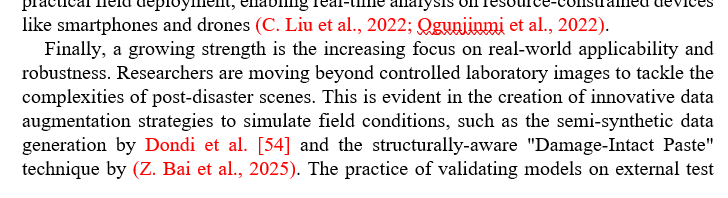
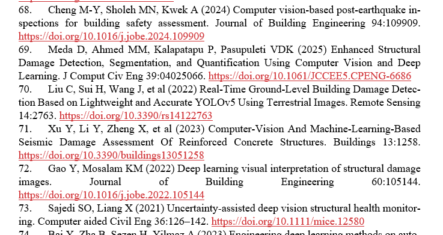
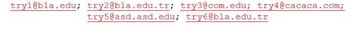

# ZoteroCiteLinker

An MS Word Add-in that creates an interactive bridge between your in-text Zotero citations and your bibliography, all from a convenient custom Ribbon tab.

This add-in scans your document for Zotero-generated citation fields (e.g., `[1]`, `(Author, 2020)`) and intelligently links them to the corresponding entries in your bibliography, allowing for instant navigation.

## 🌟 Features

* **One-Click Linking:** Automatically link all citations in the document.
* **Step-by-Step Linking:** A manual "debug" mode to process citations one by one.
* **Smart Unlinking:** Safely remove *only* the links created by this add-in, without touching your Table of Contents or other hyperlinks.
* **Structured Bookmarks:** Generates clean, human-readable bookmarks (e.g., `Cite_id1234_Title_2020_Author`) for easy navigation and management in Word's bookmark dialog.
* **Utility Functions:** Activate (or separately remove) all web URLs and email addresses in your document.
* **Cited By:** Put the cursor in a bibliography entry and see every citation that points to it, with page numbers.
* **Citation Audit:** Export an HTML report of every reference, how often it is cited and which references are never used.
* **Link Check:** Verify that the citation links in the document still reach their bibliography entries.
* **Customization:** Change the color of all Zotero citations or apply a custom Word "Character Style" for advanced formatting.
* **Compatibility:** Works with over 20 common Zotero citation styles (listed in the "How to Use" section below).
* **Cross-Platform:** One `.dotm` runs on Word for Windows and Word for macOS.

## 🖼️ Screenshots

Click to see the add-in in action (9 images)

 

<table>
  <tr>
    <td align="center"></td>
    <td align="center"></td>
    <td align="center"></td>
  </tr>
  <tr>
    <td align="center"></td>
    <td align="center"></td>
    <td align="center"></td>
  </tr>
  <tr>
    <td align="center"></td>
    <td align="center"></td>
    <td align="center"></td>
  </tr>
</table>

## 💾 Installation Instructions

This add-in is installed by placing the `.dotm` file into Word's trusted STARTUP folder. This will automatically load the "Zotero Linker" Ribbon tab every time you open Word.

### Windows

1.  **Get the File:**
    * **[Click here to download `ZoteroCiteLinker.dotm`](https://github.com/sBaydin/ZoteroCiteLinker/releases/latest/download/ZoteroCiteLinker.dotm)**
    *(You may need to right-click the link and select "Save As...")*
    * To download an older version, browse [all releases](https://github.com/sBaydin/ZoteroCiteLinker/releases).

2.  **Find your Word STARTUP Folder:**
    * Open MS Word.
    * Go to **File** -> **Options** -> **Trust Center**.
    * Click the **Trust Center Settings...** button.
    * Go to the **Trusted Locations** tab.
    * In the list, find the location with the description "**User STARTUP**".
    * **Click on it and copy the full path** from the bottom of the window.
    * The path will look something like this:
        `C:\Users\<YourUserName>\AppData\Roaming\Microsoft\Word\STARTUP`

3.  **Copy the Add-in File:**
    * Open Windows File Explorer.
    * Paste the path you just copied into the address bar and press **Enter**.
    * Copy the `ZoteroCiteLinker.dotm` file into this `STARTUP` folder.

4.  **Restart Word & Enable Content:**
    * Close MS Word completely and re-open it.
    * When Word starts, it will likely show a yellow **"SECURITY WARNING"** bar at the top, stating "Macros have been disabled."
    * You **must** click the **"Enable Content"** button. This tells Word to trust the add-in.
    * You should now see a new **"Zotero Linker"** tab on your Word Ribbon.

### macOS

The same `.dotm` runs on Word for macOS; there is no separate Mac build.

1.  **Get the File:** use the same download link above.
2.  **Open Word's STARTUP folder:** in Finder, choose **Go > Go to Folder...** (`Shift + Command + G`) and enter:
    `~/Library/Group Containers/UBF8T346G9.Office/User Content/Startup/Word`
3.  **Copy the Add-in File:** move `ZoteroCiteLinker.dotm` into that folder.
4.  **Restart Word & Enable Macros:** close and reopen Word, then click **Enable Macros** when prompted. The **Zotero Linker** tab should appear.

macOS Word does not provide `Scripting.Dictionary`, `VBScript.RegExp` or `MSXML2`, so the add-in has a Mac-specific code path (included in the shipped `.dotm`).

The source in `src/` is only needed to inspect or rebuild the add-in: import `src/ZoteroCiteLinker.bas` and `src/CustomDictionary.cls` (it must be a Class Module) with **File > Import File...** (`Option + F11` opens the VBA editor), then save as a macro-enabled template.

If you hit a macOS-specific problem, please report it in the issue tracker.

## ⚠️ Important: Backup Your Work!

Before running any macros that modify your document (like "Link All Citations" or "Set Style"), it is **strongly recommended** that you **save a backup copy** of your work.

While this add-in is designed to be safe, a macro-driven error, an unexpected interaction with other add-ins, or a mistake (like applying a Paragraph Style) could lead to unintended changes. A backup ensures you can always revert to a safe version of your document.

## 📖 How to Use: The Ribbon Guide

Here is a breakdown of each button on the "Zotero Linker" tab.

### Main Functions

* **Link All Citations (`ZCL_LinkCitationAll`)**
    * This is the main button. It first unlinks all previous citations and then automatically scans and links every Zotero citation in your document. A message will appear showing how many links were created.
    * While it runs, Word's status bar shows the progress (`citation 12 of 180`). Press **Esc** to stop early; the links created so far are kept and leftover temporary bookmarks are removed.
    * **Requirement:** The Zotero application must be running for this to work.

* **Link Selectively (`ZCL_LinkCitationSelect`)**
    * This is a debug/manual mode. It will go through the document one citation field at a time and ask you (Yes/No/Cancel) if you want to process that specific group.
    * **Requirement:** The Zotero application must be running.

* **Unlink Citations (`ZCL_UnlinkCitations`)**
    * Safely removes *only* the hyperlinks from your Zotero citations (bookmarks starting with `CITE_`). It also automatically resets their color back to black (Auto).
    * This **does not** touch other hyperlinks in your document (like web links or your Table of Contents).

### Utility Functions

* **Activate URLs (in Bib) (`ZCL_LinkBibliographyURLs`)**
    * This utility scans *only* your Zotero Bibliography section and converts all text URLs (e.g., `http://...`) into active, clickable hyperlinks.

* **Activate Emails (All) (`ZCL_LinkEmails`)**
    * This utility scans your *entire document* (not just the bibliography) and converts all email addresses (e.g., `name@domain.com`) into active `mailto:` links.

* **Unlink Web/Mail (`ZCL_UnlinkURLsMail`)**
    * The reverse of the above. This removes all `http://` and `mailto:` hyperlinks from the entire document.
    * This **does not** touch your Zotero citation links.

### Analysis

* **Cited By (`ZCL_CitedBy`)**
    * Put the cursor anywhere inside a bibliography entry, then press this button. A dialog shows the reference and lists every citation that points to it, each with its page number and a short text snippet.
    * Type the number of an entry and press OK to jump straight to that citation in the text. Press Cancel (or leave the box empty) to close without moving.
    * It reads the links that **Link All** created, so run Link All first if the bibliography has no links yet. Nothing is written into the document.

* **Citation Audit (`ZCL_CitationAudit`)**
    * Produces a single self-contained HTML report about the citation structure of the document:
        * a summary (references, citation links, uncited references, citation fields, fields without a link, links to a missing entry),
        * the list of **references that are never cited**, which is the fastest way to find a source you forgot to use,
        * every reference with its citation count and the pages it is cited on.
    * The report is **not** written to a fixed path. A Save As dialog opens with a suggested name (`<document>-citation-audit.html`) next to the document; you choose the folder and file name, and nothing is saved if you cancel.
    * The file opens correctly on any platform, and it can be opened afterwards in any browser or kept as an appendix for a supervisor.

* **Check Links (`ZCL_CheckLinks`)**
    * Scans the document and reports how many Zotero citation fields exist, how many of them carry a link, how many are not linked, and how many links point to a bibliography bookmark that no longer exists.
    * Broken targets usually appear after Zotero rebuilds the bibliography and a title or year changes. The dialog lists the first few and offers to run **Link All** again to repair them.
    * It also removes any leftover temporary bookmarks from an interrupted linking run.

### Formatting & Help

* **Change Color (`ZCL_ChangeColor`)**
    * Opens a simple menu asking you to pick a color by number (Blue, Red, Auto/Black, etc.). This will apply your chosen color to all Zotero citation fields in the document.

* **Set Style (`ZCL_SetCitationStyle`)**
    * (Advanced) Allows you to apply a specific Word "Character Style" (e.g., "Emphasis") to your citations for custom formatting. A warning will appear, as applying a "Paragraph Style" by mistake can reformat your document.

* **Supported Styles (`ZCL_SupportedStyles`)**
    * Displays a pop-up box listing all 21 citation styles supported by the add-in's engine, grouped by type:

| Style Type | Proper Name | Zotero Style ID |
| :--- | :--- | :--- |
| **Author-Year** | American Political Science Ass. | `american-political-science-association` |
| **Author-Year** | American Psychological Ass. (APA) | `apa` |
| **Author-Year** | American Sociological Ass. (ASA) | `american-sociological-association` |
| **Author-Year** | Chicago Manual of Style (Author-Date) | `chicago-author-date` |
| **Author-Year** | China National Standard (Author-Date) | `china-national-standard-gb-t-7714-2015-author-date` |
| **Author-Year** | Cite Them Right - Harvard | `harvard-cite-them-right` |
| **Author-Year** | Elsevier - Harvard | `elsevier-harvard` |
| **Author-Year** | Molecular Plant | `molecular-plant` |
| **Author-only** | Modern Language Association (MLA) | `modern-language-association` |
| **Numeric** | American Chemical Society (ACS) | `american-chemical-society` |
| **Numeric** | American Physical Society (APS) | `american-physics-society` |
| **Numeric** | Physical Review Letters (PRL) | `physical-review-letters` |
| **Numeric** | American Medical Association (AMA) | `american-medical-association` |
| **Numeric** | Archives of Comp. Methods in Eng. | `archives-of-computational-methods-in-engineering` |
| **Numeric** | BMC Medicine | `bmc-medicine` |
| **Numeric** | China National Standard (Numeric) | `china-national-standard-gb-t-7714-2015-numeric` |
| **Numeric** | Elsevier - NLM/Vancouver | `elsevier-vancouver` |
| **Numeric** | SAGE - NLM/Vancouver (brackets) | `sage-vancouver-brackets` |
| **Numeric** | IEEE | `ieee` |
| **Numeric** | Nature | `nature` |
| **Numeric** | Vancouver | `vancouver` |

* **About (`ZCL_About`)**
    * Shows the add-in version, the author, the GitHub address and the license.
    * The older `ZCL_Information` callback is kept as an alias, so templates built with an earlier Ribbon still open the About dialog.

* **Check for Updates (`ZCL_CheckUpdates`)**
    * Asks GitHub for the newest published release and compares it with the running version. If a newer release exists, it offers to open the download page.
    * Word for Windows can query GitHub directly. Word for macOS cannot make HTTP requests from VBA, so there the button offers to open the releases page instead.

* **GitHub (`ZCL_OpenGitHub`)**
    * Opens the repository page in your default browser.

## 🤝 Acknowledgments

This add-in was built by modifying the excellent foundational code from:
* [altairwei/ZoteroLinkCitation](https://github.com/altairwei/ZoteroLinkCitation)
* [8gengen8/ZoteroCitationLink-lgg](https://github.com/8gengen8/ZoteroCitationLink-lgg)

## 📜 License

This project is licensed under the MIT License - see the [LICENSE](LICENSE) file for details.
